# Sparse Coding for Spiking Neural networks

See [`Alternative_Coding_Methods.pdf`](Alternative_Coding_Methods.pdf) for formulations.

To visualize Phi, run ```python SNN/config.py n``` for an index n in Phi, or just run ```python SNN/config.py``` to see all of it.
---

# Kodak sweep over λ (`runner.py`, `output/runner_kodak`)

All numbers and figures in this section come from `output/runner_kodak/results.jsonl` (31,200 runs). The figures are captures of the `runner.py` dashboard.

## Setup

| | |
|---|---|
| Images | Kodak `kodim01`–`kodim24`, grayscale, long side 512 px, cropped to a multiple of 8, whitened (same preprocessing as `sparse_code_image.py --preprocess whiten`), 8×8 patches scaled to unit variance per image |
| λ | 0.1, 0.15, 0.2, 0.3, 0.5 |
| Dictionaries | One per λ, `output/runner/dictionaries/phi_whiten_lam<λ>.npz`: 64×128, `SNN/phi_learner.learn_phi` (non-negative ISTA, 10,000 iterations, batch 256, η = 0.1, 200 ISTA steps) on 100k whitened patches of all 24 Kodak images, seed 0 |
| Step units | 1/L = 1/‖Φ‖₂² of each λ's dictionary; a step of k/L means ε·lr = k/L |
| Reference | Non-negative LCA, ε = 1, 1/L, at 1, 2, 5, 10, 20, 50, 100, 200, 500, 1000 iterations. 1000 vs 500 iterations: largest change 0.008 dB over all images and λ |
| Rate (live) | Configs below, input spike value 1, dt = 1/(2.5·max\|X\|), decode the last 50% of steps; 8, 16, 32, 64, 128, …, 65,536 steps |
| Latency (live) | ε = 0.1, step 4/L, T = 2.5·max\|X\|, S ∈ {512, 1024, 2048, 4096}, cycles = N/S for N = 128, …, 65,536 steps (N ≥ S) |
| TP (live) | ε = 0.2, step 3/L, T = 2.5·max\|X\|, bits ∈ {8, 9, 10, 11}, cycles 1, 2, 4, …, 128 (steps = bits × cycles) |
| Snapshot modes | Latency, rate and TP snapshot: ε = 1, step 1.95/L; latency and rate snapshot on the latency S and step grid, TP snapshot on the TP grid |
| Du et al. | `baselines/lesscool_ratecodedSLCA.py`, dt = 0.01, all steps decoded; 128, …, 65,536 steps |

SNR is computed as in the section below: 10·log10(mean(W²)/MSE) on the whitened image W. "Recurrent spikes" and "input spikes" are per patch.

### Live-rate configs

Chosen per λ on `kodim01` from θ ∈ {1, 4, 16, 64} × ε ∈ {0.1, 0.5, 1} × step ∈ {0.53, 2.65, 10.6, 42.5}/L. Fewest spikes: most of the targets 1, 0.5 and 0.2 dB below kodim01's LASSO optimum reached and held, then the lowest geometric mean of the spikes needed. Highest SNR per step: highest mean SNR over 1,024–65,536 steps. Sweep scores: `output/runner_kodak/rate_select.json`.

| λ | θ | Chosen for | ε | Step ε·lr | lr |
|---|---:|---|---:|---:|---:|
| 0.1 | 1 | fewest spikes | 1 | 10.62/L | 10.6/L |
| 0.1 | 1 | highest SNR per step | 1 | 42.47/L | 42.5/L |
| 0.1 | 4 | fewest spikes | 0.1 | 10.62/L | 106.2/L |
| 0.1 | 4 | highest SNR per step | 1 | 42.47/L | 42.5/L |
| 0.1 | 16 | fewest spikes | 1 | 10.62/L | 10.6/L |
| 0.1 | 16 | highest SNR per step | 1 | 42.47/L | 42.5/L |
| 0.1 | 64 | fewest spikes | 1 | 10.62/L | 10.6/L |
| 0.1 | 64 | highest SNR per step | 0.5 | 2.65/L | 5.3/L |
| 0.15 | 1 | fewest spikes | 0.5 | 10.62/L | 21.2/L |
| 0.15 | 1 | highest SNR per step | 1 | 42.47/L | 42.5/L |
| 0.15 | 4 | fewest spikes and highest SNR per step | 1 | 42.47/L | 42.5/L |
| 0.15 | 16 | fewest spikes | 1 | 10.62/L | 10.6/L |
| 0.15 | 16 | highest SNR per step | 1 | 42.47/L | 42.5/L |
| 0.15 | 64 | fewest spikes and highest SNR per step | 1 | 10.62/L | 10.6/L |
| 0.2 | 1 | fewest spikes | 0.5 | 10.62/L | 21.2/L |
| 0.2 | 1 | highest SNR per step | 1 | 42.47/L | 42.5/L |
| 0.2 | 4 | fewest spikes | 0.1 | 10.62/L | 106.2/L |
| 0.2 | 4 | highest SNR per step | 1 | 42.47/L | 42.5/L |
| 0.2 | 16 | fewest spikes | 1 | 10.62/L | 10.6/L |
| 0.2 | 16 | highest SNR per step | 1 | 42.47/L | 42.5/L |
| 0.2 | 64 | fewest spikes and highest SNR per step | 1 | 10.62/L | 10.6/L |
| 0.3 | 1 | fewest spikes | 0.5 | 10.62/L | 21.2/L |
| 0.3 | 1 | highest SNR per step | 1 | 42.47/L | 42.5/L |
| 0.3 | 4 | fewest spikes | 0.1 | 10.62/L | 106.2/L |
| 0.3 | 4 | highest SNR per step | 0.5 | 42.47/L | 84.9/L |
| 0.3 | 16 | fewest spikes | 1 | 10.62/L | 10.6/L |
| 0.3 | 16 | highest SNR per step | 1 | 42.47/L | 42.5/L |
| 0.3 | 64 | fewest spikes and highest SNR per step | 1 | 10.62/L | 10.6/L |
| 0.5 | 1 | fewest spikes | 0.5 | 10.62/L | 21.2/L |
| 0.5 | 1 | highest SNR per step | 1 | 42.47/L | 42.5/L |
| 0.5 | 4 | fewest spikes | 1 | 10.62/L | 10.6/L |
| 0.5 | 4 | highest SNR per step | 1 | 42.47/L | 42.5/L |
| 0.5 | 16 | fewest spikes | 1 | 10.62/L | 10.6/L |
| 0.5 | 16 | highest SNR per step | 0.5 | 10.62/L | 21.2/L |
| 0.5 | 64 | fewest spikes and highest SNR per step | 1 | 10.62/L | 10.6/L |

### Definitions used in the tables

- **Reference**: LCA after 1000 iterations, per image and λ.
- **Reach G**: a run reaches G when its SNR is at least reference − G dB. Every checkpoint is its own run.
- **Spikes (or steps) to reach G**: for each image, the fewest recurrent spikes (or timesteps) over every run of that method that reaches G, over all its settings (all rate configs, all latency S, all TP bits) and checkpoints. Tables show the median over the 24 images; "(n/24)" when only n images reach G, with the median over those n.
- **Bold**: lowest median among the methods that reach G on all 24 images.
- **Figures**: mean over the 24 images per setting and checkpoint, at one latency S (512), one TP bit count (9) and every rate config. LCA's line is the mean reference.

## SNR against recurrent spikes

λ = 0.1, 0.15, 0.2, 0.3, 0.5, in reading order (log x-axis).

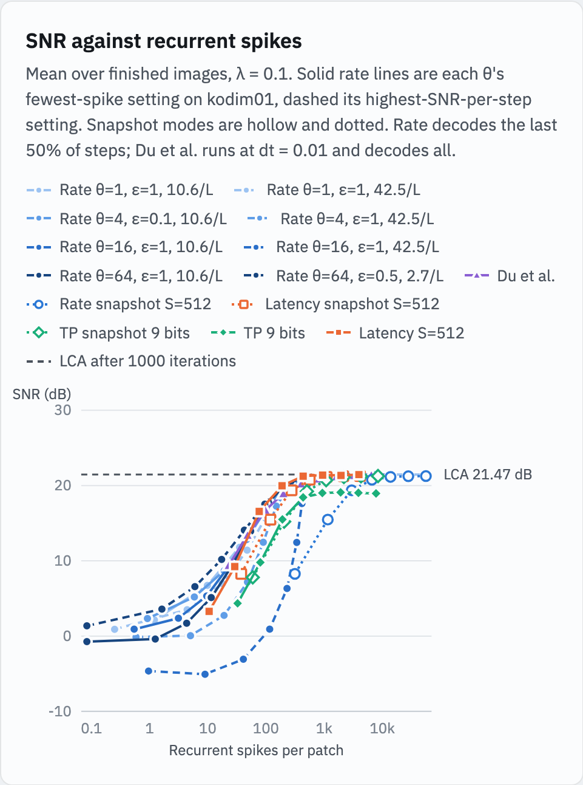
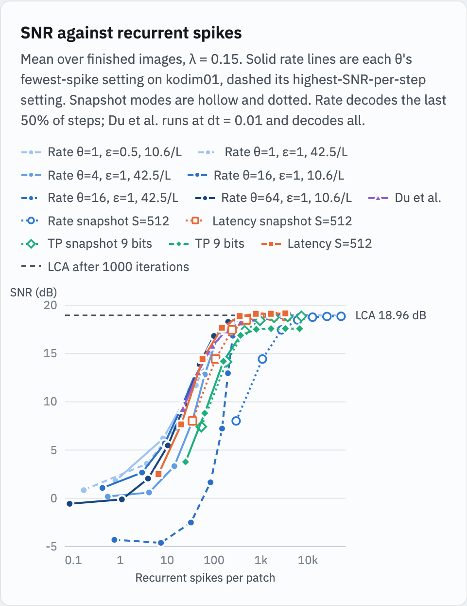
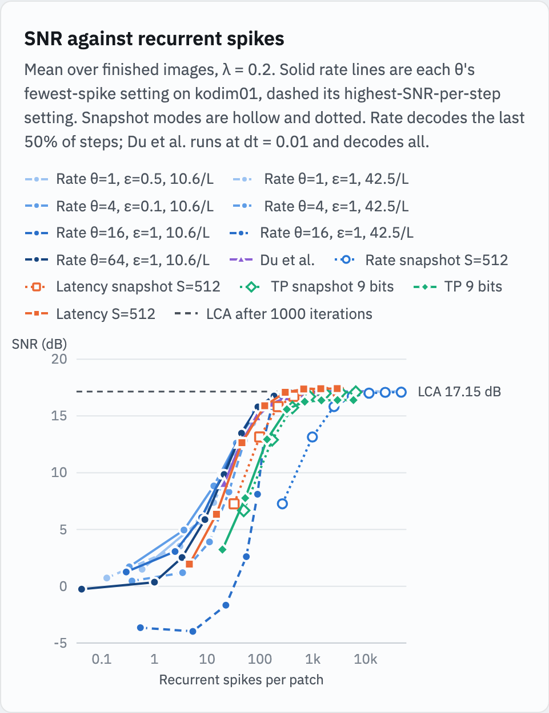
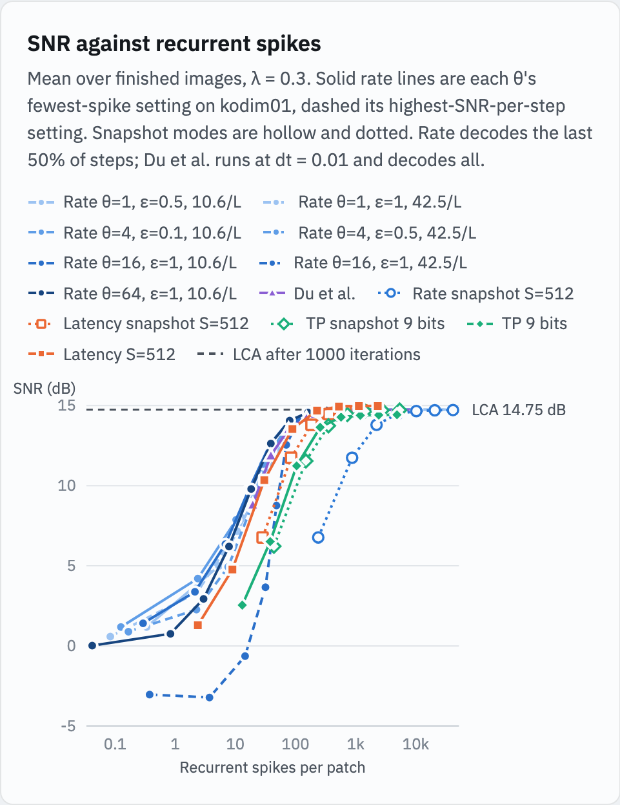
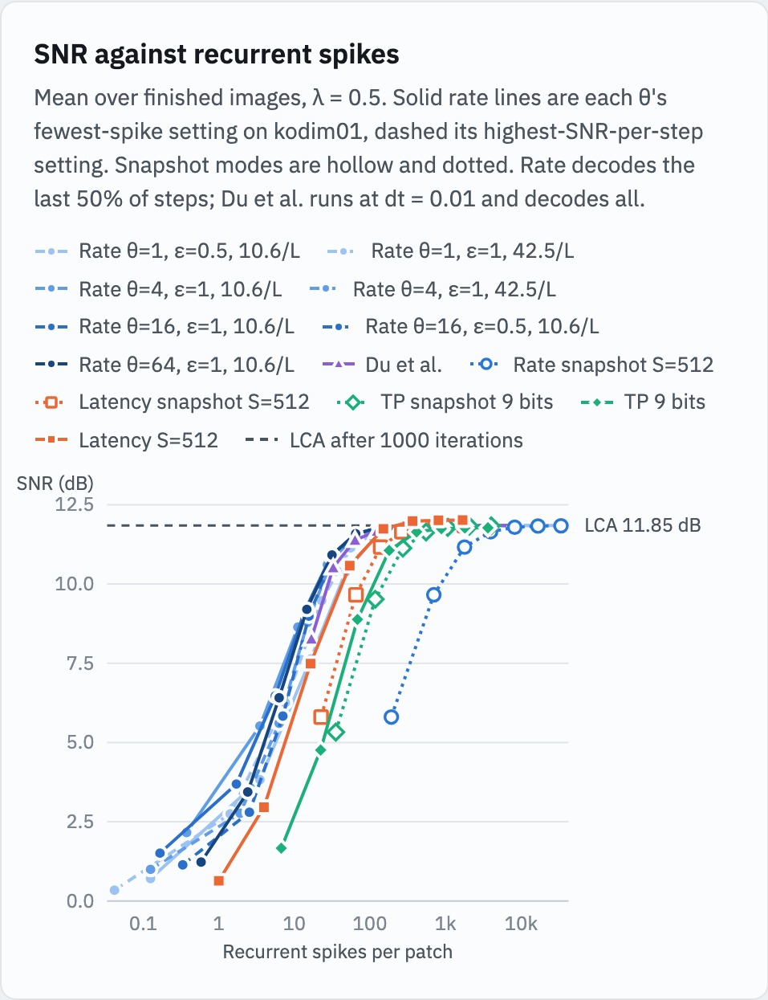

### Recurrent spikes per patch to reach reference − G (median over images)

| λ | G (dB) | Rate | Latency | Du et al. | Latency snap. | TP | TP snap. | Rate snap. |
|---|---|---:|---:|---:|---:|---:|---:|---:|
| 0.1 | 3 | **152** | 192 | 202 | 278 | 496 | 374 | 2,747 |
|  | 1 | **311** | 452 | 822 | 584 | 3,036 (3/24) | 1,060 | 6,585 |
|  | 0.5 | **439** | 454 | 1,647 | 740 | never | 2,024 | 12,868 |
|  | 0.2 | 788 | **464** | 3,298 | 1,233 | never | 3,088 | 28,408 |
|  | 0.1 | **1,080** | 476 (21/24) | 6,601 | 1,692 (16/24) | never | 5,683 | 56,877 (15/24) |
| 0.15 | 3 | **87** | 148 | 173 | 246 | 285 | 324 | 2,532 |
|  | 1 | **188** | 362 | 374 | 497 | 1,050 (14/24) | 725 | 5,628 |
|  | 0.5 | **290** | 362 | 750 | 518 | 3,952 (4/24) | 1,231 | 7,021 |
|  | 0.2 | 448 | **364** | 1,518 | 998 | never | 2,245 | 14,453 |
|  | 0.1 | 710 | **370** | 3,036 | 1,279 | never | 4,013 | 36,434 (23/24) |
| 0.2 | 3 | **62** | 123 | 87 | 220 | 256 | 299 | 2,324 |
|  | 1 | **131** | 306 | 284 | 440 | 728 (23/24) | 622 | 5,182 |
|  | 0.5 | **184** | 306 | 404 | 451 | 1,082 (16/24) | 868 | 5,596 |
|  | 0.2 | 328 | **306** | 1,396 | 866 | 2,437 (4/24) | 1,694 | 11,652 |
|  | 0.1 | 456 | **320** | 1,560 | 983 | 5,212 (1/24) | 2,841 | 23,214 |
| 0.3 | 3 | **32** | 89 | 43 | 106 | 210 | 206 | 1,324 |
|  | 1 | **74** | 228 | 154 | 188 | 324 | 374 | 2,302 |
|  | 0.5 | **117** | 228 | 249 | 359 | 608 | 552 | 4,510 |
|  | 0.2 | **180** | 228 | 612 | 572 | 1,380 (16/24) | 1,172 | 8,572 |
|  | 0.1 | 289 | **230** | 1,200 | 698 | 1,674 (13/24) | 1,522 | 10,688 |
| 0.5 | 3 | **13** | 54 | 30 | 64 | 66 | 80 | 628 |
|  | 1 | **34** | 152 | 62 | 137 | 152 | 202 | 1,617 |
|  | 0.5 | **52** | 152 | 72 | 262 | 350 | 422 | 3,600 |
|  | 0.2 | **97** | 152 | 140 | 284 | 450 | 630 | 5,322 |
|  | 0.1 | **127** | 192 | 257 | 486 | 585 (23/24) | 834 | 7,524 |

### Images (of 24) where one method needs fewer recurrent spikes than the other to reach reference − G

Counted over images where both reach G.

| λ | G (dB) | Latency < rate | Rate < latency | Du < rate | Latency < Du | Du < latency |
|---|---|---:|---:|---:|---:|---:|
| 0.1 | 3 | 6/24 | 18/24 | 3/24 | 19/24 | 3/24 |
|  | 1 | 1/24 | 23/24 | 1/24 | 23/24 | 1/24 |
|  | 0.5 | 10/24 | 14/24 | 0/24 | 24/24 | 0/24 |
|  | 0.2 | 24/24 | 0/24 | 0/24 | 24/24 | 0/24 |
|  | 0.1 | 21/21 | 0/21 | 0/24 | 21/21 | 0/21 |
| 0.15 | 3 | 0/24 | 24/24 | 1/24 | 20/24 | 4/24 |
|  | 1 | 1/24 | 23/24 | 0/24 | 18/24 | 5/24 |
|  | 0.5 | 7/24 | 17/24 | 1/24 | 24/24 | 0/24 |
|  | 0.2 | 23/24 | 1/24 | 0/24 | 24/24 | 0/24 |
|  | 0.1 | 24/24 | 0/24 | 0/24 | 24/24 | 0/24 |
| 0.2 | 3 | 0/24 | 24/24 | 0/24 | 0/24 | 24/24 |
|  | 1 | 1/24 | 23/24 | 2/24 | 17/24 | 7/24 |
|  | 0.5 | 0/24 | 24/24 | 0/24 | 24/24 | 0/24 |
|  | 0.2 | 16/24 | 8/24 | 0/24 | 24/24 | 0/24 |
|  | 0.1 | 22/24 | 2/24 | 0/24 | 24/24 | 0/24 |
| 0.3 | 3 | 0/24 | 24/24 | 3/24 | 0/24 | 23/24 |
|  | 1 | 0/24 | 24/24 | 0/24 | 0/24 | 24/24 |
|  | 0.5 | 0/24 | 24/24 | 1/24 | 14/24 | 10/24 |
|  | 0.2 | 5/24 | 19/24 | 1/24 | 23/24 | 1/24 |
|  | 0.1 | 22/24 | 2/24 | 1/24 | 24/24 | 0/24 |
| 0.5 | 3 | 0/24 | 24/24 | 1/24 | 0/24 | 24/24 |
|  | 1 | 0/24 | 24/24 | 2/24 | 0/24 | 24/24 |
|  | 0.5 | 0/24 | 24/24 | 1/24 | 0/24 | 24/24 |
|  | 0.2 | 0/24 | 24/24 | 3/24 | 10/24 | 14/24 |
|  | 0.1 | 2/24 | 21/24 | 1/24 | 15/24 | 9/24 |

### Best SNR with at most B recurrent spikes per patch (dB below the reference, median over images)

Negative values are above the reference.

| λ | B | Rate | Latency | Du et al. | Latency snap. | TP | TP snap. | Rate snap. |
|---|---|---:|---:|---:|---:|---:|---:|---:|
| 0.1 | 50 | 7.83 | 12.18 | 8.71 | 12.92 | 16.65 | 14.06 | 21.38 |
|  | 100 | 4.39 | 4.83 | 5.14 | 12.76 | 11.62 | 13.26 | 21.38 |
|  | 200 | 1.92 | 1.52 | 4.44 | 5.77 | 5.99 | 6.50 | 21.18 |
|  | 400 | 0.61 | 1.16 | 2.45 | 1.88 | 3.72 | 2.75 | 13.26 |
|  | 800 | 0.19 | -0.05 | 1.22 | 0.45 | 2.41 | 1.87 | 12.94 |
|  | 1,600 | 0.04 | -0.29 | 0.59 | 0.14 | 1.74 | 0.59 | 6.07 |
| 0.15 | 50 | 5.74 | 11.15 | 6.06 | 10.64 | 12.42 | 11.88 | 18.82 |
|  | 100 | 2.60 | 4.50 | 3.35 | 10.08 | 9.94 | 10.89 | 18.82 |
|  | 200 | 0.87 | 1.22 | 1.66 | 4.35 | 4.63 | 4.85 | 18.51 |
|  | 400 | 0.25 | 0.01 | 0.79 | 1.37 | 2.14 | 1.89 | 10.98 |
|  | 800 | 0.07 | -0.08 | 0.36 | 0.31 | 1.49 | 0.82 | 10.52 |
|  | 1,600 | 0.02 | -0.32 | 0.17 | 0.09 | 0.96 | 0.37 | 4.51 |
| 0.2 | 50 | 3.45 | 4.63 | 4.49 | 9.53 | 9.45 | 10.74 | 16.99 |
|  | 100 | 1.48 | 4.45 | 2.25 | 4.20 | 9.05 | 9.58 | 16.99 |
|  | 200 | 0.42 | 1.21 | 1.07 | 3.59 | 4.04 | 4.24 | 16.38 |
|  | 400 | 0.12 | 0.02 | 0.50 | 1.03 | 1.50 | 1.52 | 9.91 |
|  | 800 | 0.03 | -0.26 | 0.22 | 0.23 | 0.83 | 0.57 | 9.11 |
|  | 1,600 | 0.01 | -0.32 | 0.10 | 0.07 | 0.52 | 0.27 | 3.94 |
| 0.3 | 50 | 1.78 | 4.40 | 2.76 | 7.70 | 8.12 | 8.52 | 14.55 |
|  | 100 | 0.64 | 1.26 | 1.21 | 3.03 | 3.59 | 7.39 | 14.55 |
|  | 200 | 0.17 | 1.15 | 0.52 | 0.98 | 3.26 | 3.07 | 13.44 |
|  | 400 | 0.04 | 0.02 | 0.23 | 0.29 | 0.87 | 0.99 | 7.90 |
|  | 800 | 0.01 | -0.23 | 0.10 | 0.07 | 0.31 | 0.30 | 5.20 |
|  | 1,600 | 0.00 | -0.26 | 0.05 | 0.03 | 0.18 | 0.10 | 2.88 |
| 0.5 | 50 | 0.60 | 4.38 | 1.26 | 5.54 | 6.77 | 6.26 | 11.64 |
|  | 100 | 0.16 | 1.27 | 0.43 | 2.05 | 2.89 | 2.55 | 11.64 |
|  | 200 | 0.04 | 0.10 | 0.17 | 0.62 | 0.77 | 1.42 | 6.86 |
|  | 400 | 0.01 | -0.12 | 0.07 | 0.15 | 0.25 | 0.60 | 5.83 |
|  | 800 | 0.00 | -0.16 | 0.03 | 0.04 | 0.06 | 0.16 | 2.30 |
|  | 1,600 | 0.00 | -0.18 | 0.01 | 0.01 | -0.04 | 0.05 | 1.37 |

## SNR against timesteps

λ = 0.1, 0.15, 0.2, 0.3, 0.5, in reading order (log x-axis).

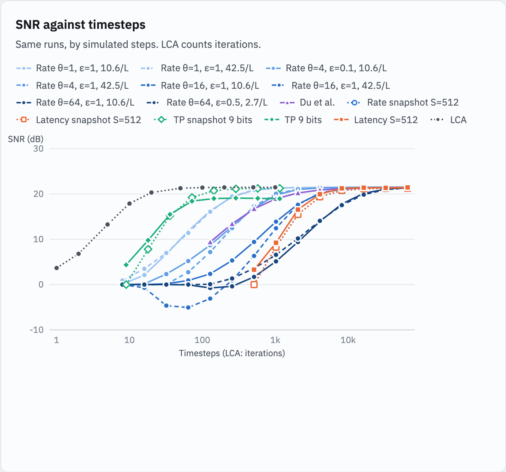
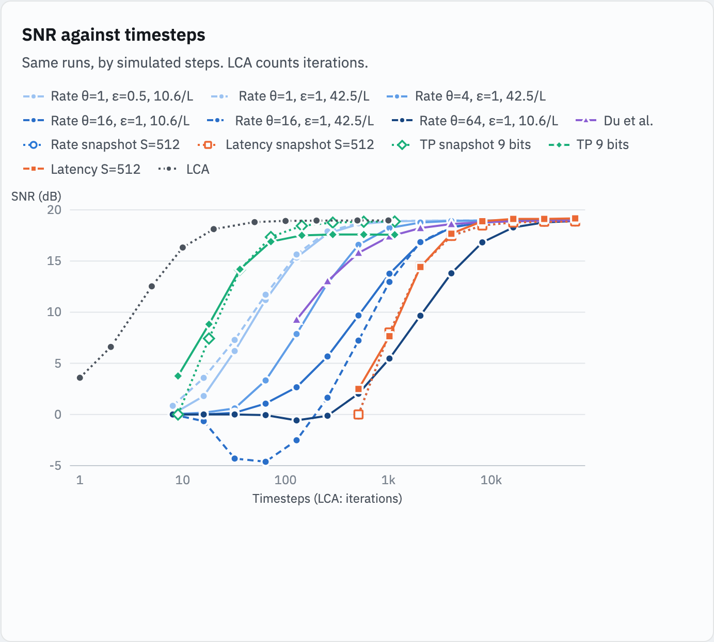
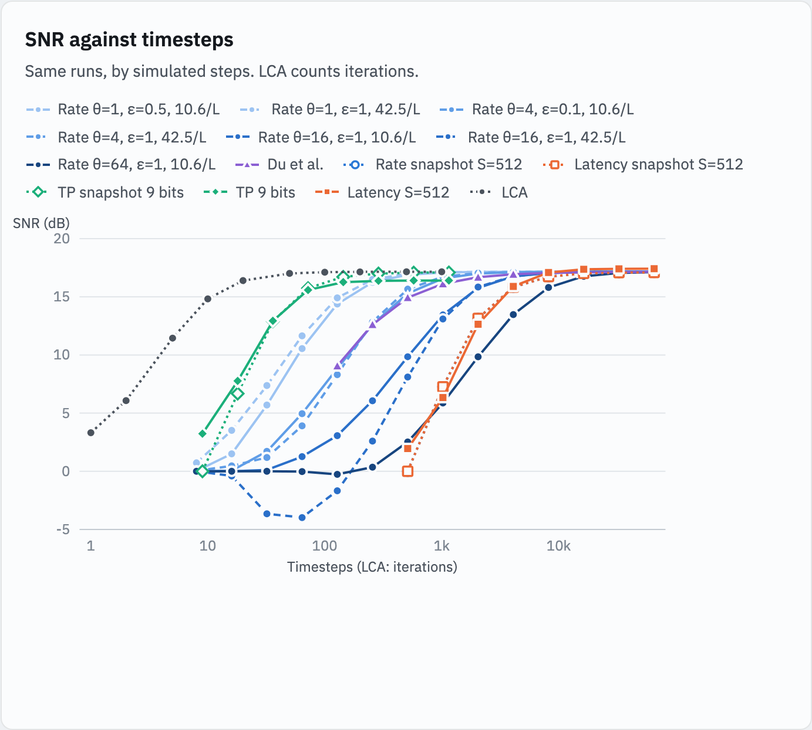
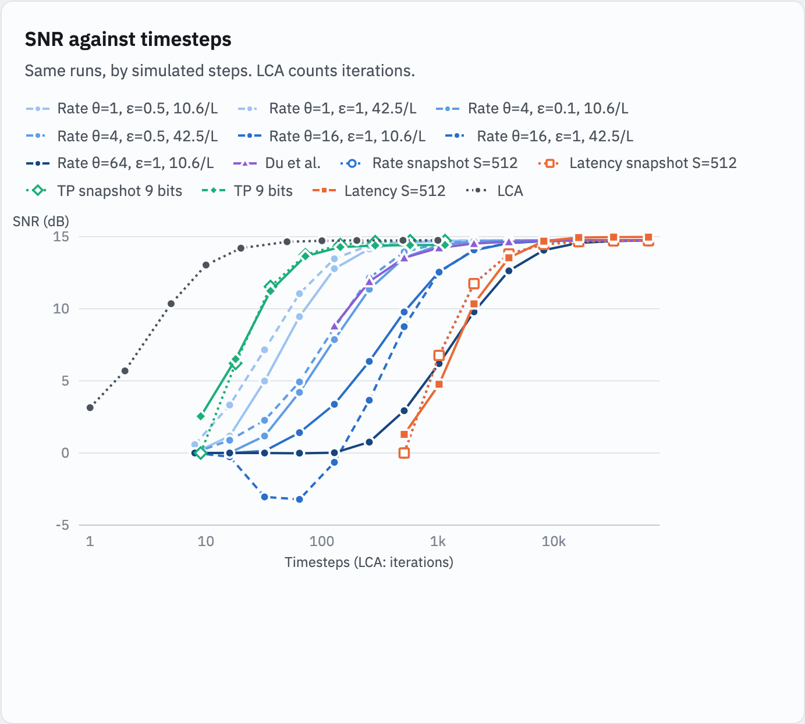
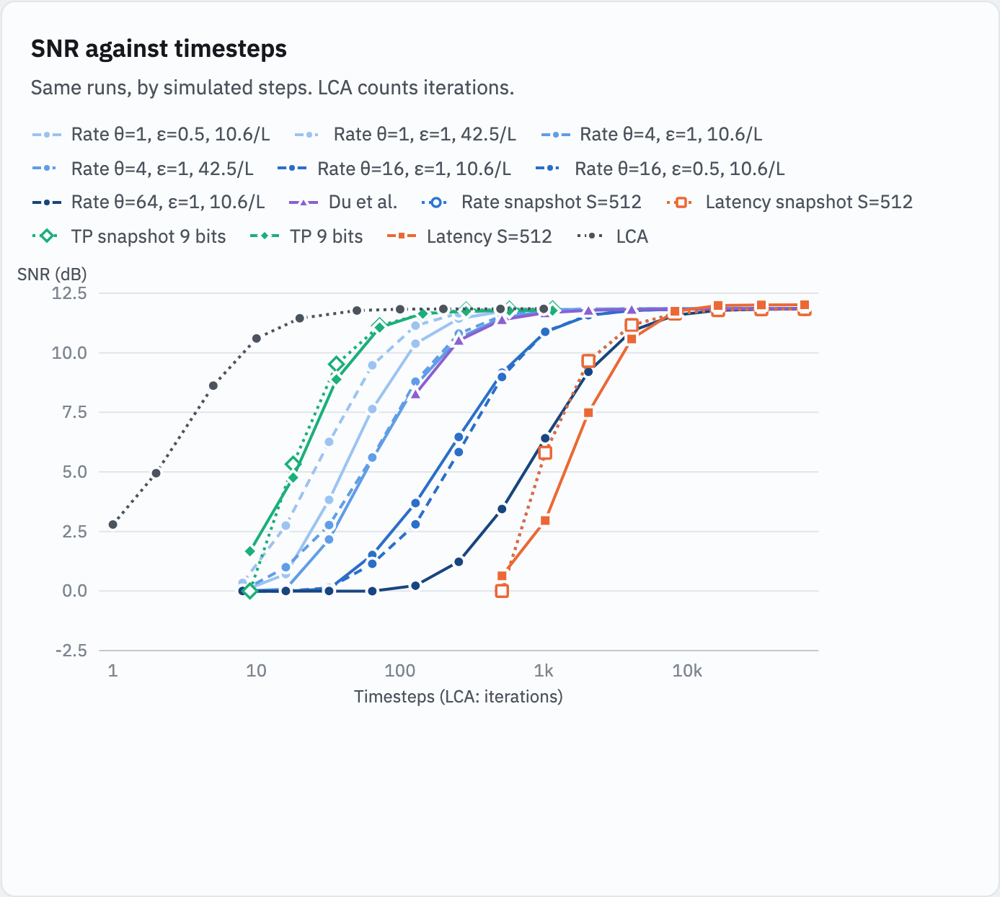

### Timesteps to reach reference − G (median over images)

The last two columns count images (of those where both reach G) where TP needs fewer timesteps than live rate.

| λ | G (dB) | TP snap. | TP | Rate | Du et al. | Latency | Latency snap. | Rate snap. | TP snap. < rate | TP < rate |
|---|---|---:|---:|---:|---:|---:|---:|---:|---:|---:|
| 0.1 | 3 | **64** | 80 | 256 | 1,024 | 4,096 | 4,096 | 4,096 | 24/24 | 22/24 |
|  | 1 | **144** | 352 (3/24) | 512 | 4,096 | 8,192 | 8,192 | 8,192 | 24/24 | 2/3 |
|  | 0.5 | **288** | never | 1,024 | 8,192 | 8,192 | 16,384 | 16,384 | 24/24 | – |
|  | 0.2 | **336** | never | 1,024 | 16,384 | 12,288 | 32,768 | 32,768 | 24/24 | – |
|  | 0.1 | **640** | never | 2,048 | 32,768 | 16,384 (21/24) | 65,536 (16/24) | 65,536 (15/24) | 24/24 | – |
| 0.15 | 3 | **64** | 64 | 256 | 1,024 | 4,096 | 4,096 | 4,096 | 24/24 | 24/24 |
|  | 1 | **128** | 168 (14/24) | 384 | 2,048 | 8,192 | 8,192 | 8,192 | 24/24 | 14/14 |
|  | 0.5 | **160** | 528 (4/24) | 512 | 4,096 | 8,192 | 8,192 | 8,192 | 24/24 | 1/4 |
|  | 0.2 | **320** | never | 1,024 | 8,192 | 8,192 | 16,384 | 16,384 | 24/24 | – |
|  | 0.1 | **640** | never | 1,024 | 16,384 | 8,192 | 65,536 | 65,536 (23/24) | 23/24 | – |
| 0.2 | 3 | **64** | 64 | 128 | 512 | 4,096 | 4,096 | 4,096 | 22/24 | 22/24 |
|  | 1 | **128** | 144 (23/24) | 256 | 2,048 | 8,192 | 8,192 | 8,192 | 22/24 | 19/23 |
|  | 0.5 | **144** | 176 (16/24) | 512 | 2,048 | 8,192 | 8,192 | 8,192 | 24/24 | 14/16 |
|  | 0.2 | **288** | 352 (4/24) | 512 | 8,192 | 8,192 | 16,384 | 16,384 | 23/24 | 3/4 |
|  | 0.1 | **352** | 704 (1/24) | 1,024 | 8,192 | 8,192 | 32,768 | 32,768 | 23/24 | 0/1 |
| 0.3 | 3 | **44** | 64 | 128 | 256 | 4,096 | 4,096 | 4,096 | 22/24 | 18/24 |
|  | 1 | **76** | 80 | 256 | 1,024 | 8,192 | 4,096 | 4,096 | 23/24 | 24/24 |
|  | 0.5 | **128** | 144 | 256 | 2,048 | 8,192 | 8,192 | 8,192 | 22/24 | 20/24 |
|  | 0.2 | **256** | 320 (16/24) | 512 | 4,096 | 8,192 | 16,384 | 16,384 | 20/24 | 14/16 |
|  | 0.1 | **288** | 352 (13/24) | 512 | 8,192 | 8,192 | 16,384 | 16,384 | 21/24 | 12/13 |
| 0.5 | 3 | **32** | 32 | 64 | 256 | 4,096 | 2,048 | 2,048 | 23/24 | 21/24 |
|  | 1 | **64** | 64 | 128 | 512 | 8,192 | 4,096 | 4,096 | 22/24 | 22/24 |
|  | 0.5 | **128** | 128 | 256 | 512 | 8,192 | 8,192 | 8,192 | 16/24 | 16/24 |
|  | 0.2 | 160 | **144** | 256 | 1,024 | 8,192 | 12,288 | 8,192 | 19/24 | 23/24 |
|  | 0.1 | **256** | 176 (23/24) | 512 | 2,048 | 16,384 | 16,384 | 16,384 | 20/24 | 23/23 |

## Total spikes (recurrent + input) to reach reference − G (median over images)

Du et al.'s runs record 0 input spikes.

| λ | G (dB) | Rate | Latency | Du et al. | Latency snap. | TP | TP snap. | Rate snap. |
|---|---|---:|---:|---:|---:|---:|---:|---:|
| 0.1 | 1 | 1,085 | 1,412 | 822 | 1,556 | 9,083 (3/24) | 3,000 | 19,704 |
|  | 0.1 | 4,091 | 1,471 (21/24) | 6,601 | 4,653 (16/24) | never | 16,218 | 165,641 (15/24) |
| 0.15 | 1 | 820 | 1,323 | 374 | 1,461 | 3,741 (14/24) | 2,356 | 17,978 |
|  | 0.1 | 2,460 | 1,346 | 3,036 | 3,316 | never | 12,945 | 118,192 (23/24) |
| 0.2 | 1 | 554 | 1,270 | 284 | 1,405 | 2,724 (23/24) | 2,094 | 17,532 |
|  | 0.1 | 2,006 | 1,300 | 1,560 | 2,996 | 19,122 (1/24) | 9,054 | 75,869 |
| 0.3 | 1 | 392 | 1,194 | 154 | 678 | 1,598 | 1,480 | 9,638 |
|  | 0.1 | 1,400 | 1,198 | 1,200 | 2,674 | 7,804 (13/24) | 5,848 | 42,036 |
| 0.5 | 1 | 237 | 1,117 | 62 | 620 | 914 | 962 | 7,849 |
|  | 0.1 | 912 | 1,192 | 257 | 2,419 | 3,653 (23/24) | 4,063 | 32,329 |

## Highest SNR reached, minus the reference (median over images, min to max)

Highest SNR over all settings and checkpoints of each method.

| λ | LCA-1000 SNR (dB) | Rate | Latency | Du et al. | Latency snap. | TP | TP snap. | Rate snap. |
|---|---|---:|---:|---:|---:|---:|---:|---:|
| 0.1 | 21.38 | +0.00 (+0.00 to +0.00) | +0.29 (-0.12 to +0.57) | -0.03 (-0.04 to -0.02) | -0.08 (-0.13 to -0.03) | -1.70 (-2.95 to -0.59) | -0.03 (-0.05 to -0.01) | -0.08 (-0.19 to -0.04) |
| 0.15 | 18.82 | +0.00 (-0.00 to +0.00) | +0.33 (+0.04 to +0.51) | -0.02 (-0.02 to -0.01) | -0.05 (-0.09 to -0.01) | -0.83 (-1.75 to -0.22) | -0.01 (-0.03 to -0.01) | -0.05 (-0.10 to -0.03) |
| 0.2 | 16.99 | +0.00 (-0.00 to +0.00) | +0.32 (+0.08 to +0.42) | -0.01 (-0.02 to -0.00) | -0.03 (-0.08 to -0.00) | -0.37 (-1.04 to -0.04) | -0.01 (-0.02 to -0.00) | -0.04 (-0.06 to -0.02) |
| 0.3 | 14.55 | +0.00 (+0.00 to +0.00) | +0.26 (+0.14 to +0.33) | -0.01 (-0.01 to +0.01) | -0.02 (-0.05 to -0.01) | -0.08 (-0.41 to +0.10) | -0.01 (-0.01 to -0.00) | -0.02 (-0.04 to -0.01) |
| 0.5 | 11.64 | +0.00 (+0.00 to +0.00) | +0.18 (+0.11 to +0.22) | -0.00 (-0.00 to +0.10) | -0.01 (-0.02 to -0.00) | +0.07 (-0.11 to +0.13) | -0.00 (-0.01 to -0.00) | -0.01 (-0.02 to -0.00) |

## Live-latency setting with the fewest recurrent spikes to reach reference − G (number of images)

| λ | G = 1 dB | G = 0.1 dB |
|---|---|---:|
| 0.1 | S=512, 16 cycles: 24 | S=1024, 16 cycles: 8, S=512, 16 cycles: 7, S=2048, 16 cycles: 6 |
| 0.15 | S=512, 16 cycles: 23, S=1024, 8 cycles: 1 | S=512, 16 cycles: 14, S=1024, 16 cycles: 10 |
| 0.2 | S=512, 16 cycles: 23, S=1024, 8 cycles: 1 | S=512, 16 cycles: 20, S=1024, 16 cycles: 2, S=512, 32 cycles: 2 |
| 0.3 | S=512, 16 cycles: 23, S=512, 8 cycles: 1 | S=512, 16 cycles: 21, S=1024, 16 cycles: 3 |
| 0.5 | S=512, 16 cycles: 24 | S=512, 16 cycles: 10, S=512, 32 cycles: 10, S=1024, 16 cycles: 4 |

## SNR against sparsity

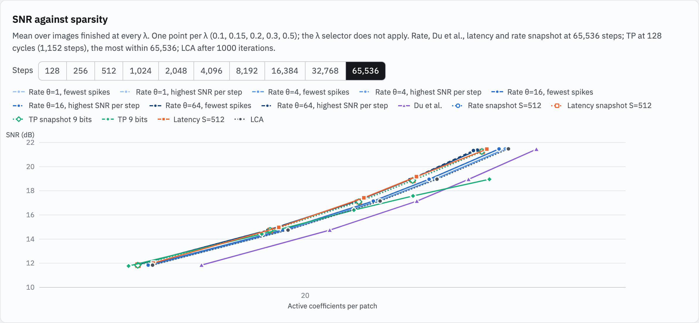

## Rate spikes per latency spike (65,536 steps)

λ = 0.1, 0.15, 0.2, 0.3, 0.5, left to right.

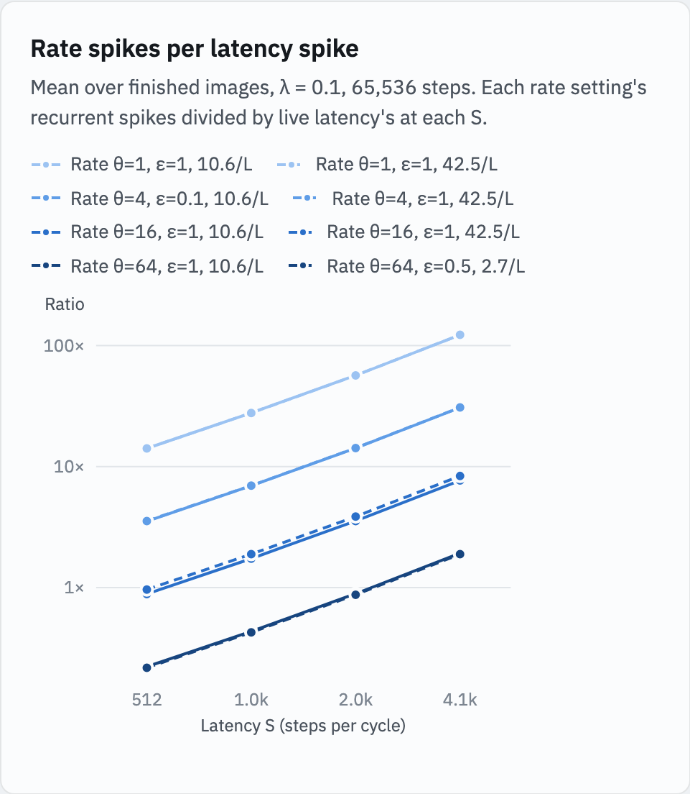 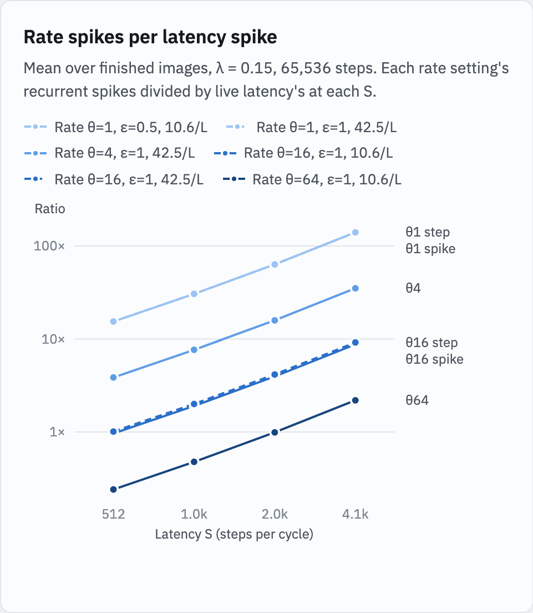 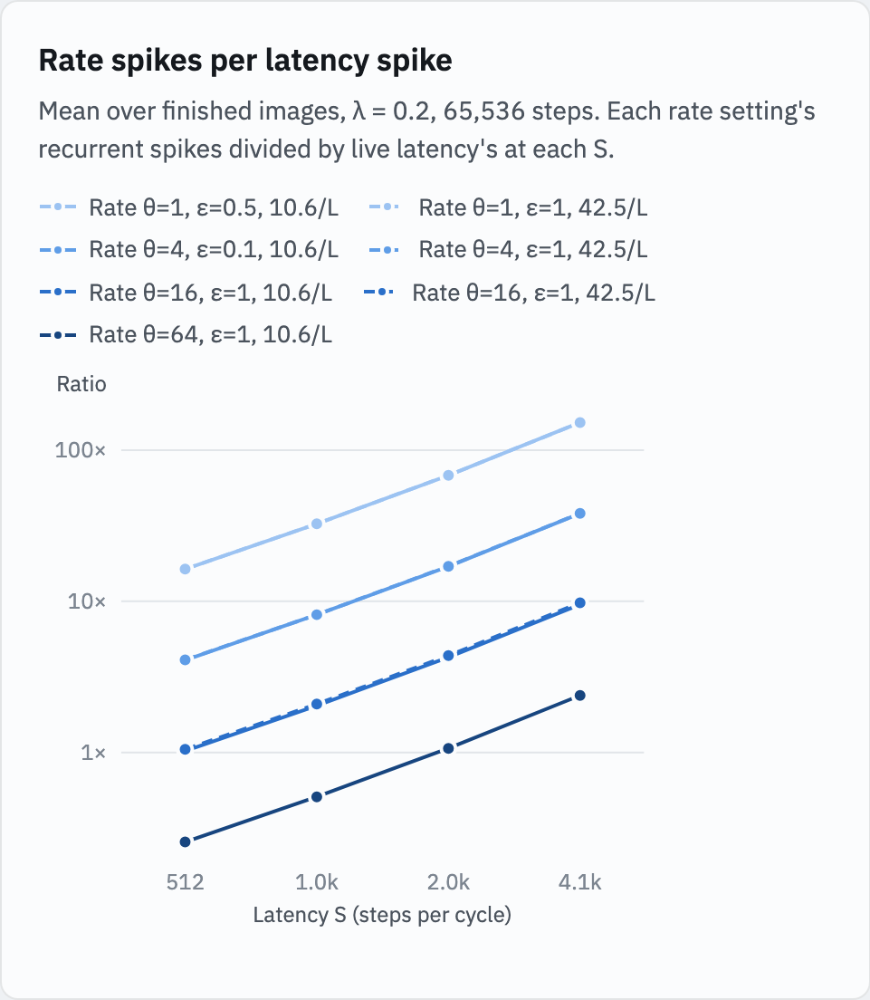  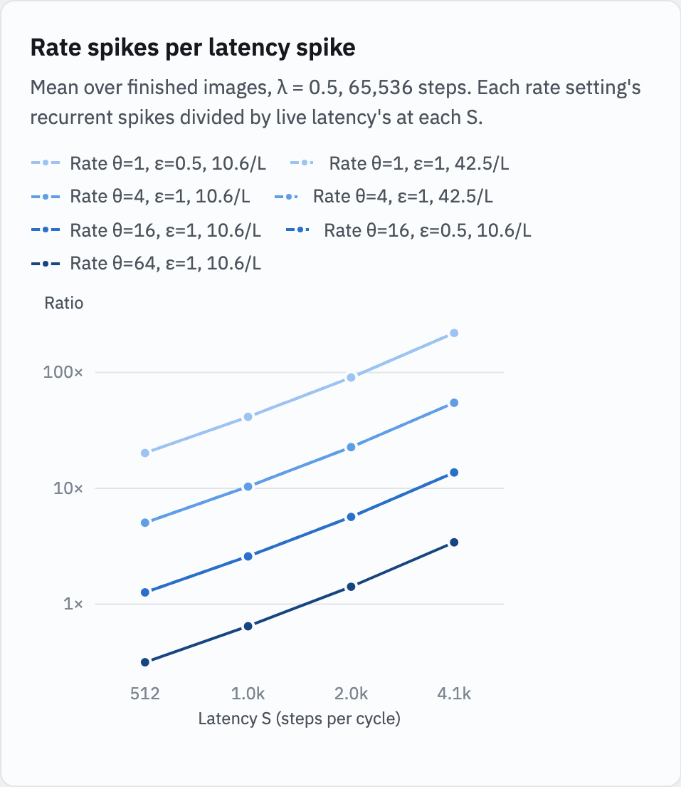

## Reproduction

```
python runner.py              # runs or resumes everything; dashboard at http://127.0.0.1:8765
python runner.py --serve      # dashboard only
```

---

# Earlier single-setting Kodak run (`output/kodak`)

Non-negative classical LCA (`nonnegative_lca`), rate-coded (`spiking_lca`), latency-coded (`latency_slca`) and temporal-pattern-coded (`temporal_pattern_slca`) spiking LCA, run on all 24 Kodak images with whitening preprocessing (`--preprocess whiten`).

## Setup

| | |
|---|---|
| Images | Kodak `kodim01`–`kodim24`, grayscale, downscaled to 512 px on the long side and cropped (512×336 or 336×512, 2688 patches each) |
| Whitening | Whole image filtered in Fourier space by R(f) = f·exp(−(f/f₀)⁴), f₀ = 0.4 cycles/pixel, f = √(fx² + fy²) (`np.fft.fftfreq` units), then cut into 8×8 patches and scaled to unit variance per image |
| Dictionary | `SNN/phi_learned_whiten.npz`: 64×128, learned with non-negative ISTA (λ = 0.1, η = 0.1, 10,000 iterations, batch 256, 200 ISTA steps) on 100k random patches of whitened Kodak images (f₀ = 0.4), columns at norm 1 |
| Parameters | λ = 0.1, ε = 0.1, lr = 1/‖Φ‖₂² = 0.188 (`SNN/config.py`) |
| Non-negative LCA | 400 iterations, a = max(u − λ·lr, 0) (`classical/nonnegative_LCA.py`) |
| Rate | 204,800 steps, dt = 1 / max\|x\| per image |
| Latency | 400 cycles × 512 steps = 204,800 steps, T = max\|x\| per image, leftover v carried across cycles (see Rounding error) |
| Temporal pattern | 400 cycles × 9 bits = 3,600 steps, same T, so q = T/512, the same grid as latency, leftover v carried across cycles |

Metric: SNR = 10·log10(mean(W²) / MSE), where W is the whitened image and MSE = mean((Ŵ − W)²), with Ŵ the reconstruction Φa put back together and the scale undone, before unwhitening. "Active" is the number of nonzero coefficients per patch.

## Summary (mean ± std over 24 images)

| Method | SNR (dB) | Active / patch | Recurrent spikes / patch | Input spikes / patch | Steps | Wall-clock / image |
|---|---:|---:|---:|---:|---:|---:|
| Non-negative LCA | 21.14 ± 0.74 | 37.3 ± 5.1 | — | — | 400 | — |
| Rate | 21.38 ± 0.71 | 40.9 ± 5.2 | 439,996 | 860,211 | 204,800 | 440 s |
| Latency | 20.59 ± 0.75 | 35.9 ± 5.4 | 15,452 | 25,011 | 204,800 | 541 s |
| Temporal pattern | 20.99 ± 0.73 | 35.9 ± 5.4 | 37,794 | 65,999 | 3,600 | 6.2 s |

Wall-clock time was measured with 6 jobs running at once, 3 threads each. Earlier results are in `legacy_tests/`.

## Per-image SNR (dB) and active coefficients per patch

| Image | LCA | Rate | Latency | TP | Active (LCA) | Active (rate) | Active (lat / TP) |
|---|---:|---:|---:|---:|---:|---:|---:|
| kodim01 | 20.63 | 20.70 | 19.00 | 20.28 | 42.8 | 45.7 | 42.1 / 42.2 |
| kodim02 | 20.25 | 20.60 | 20.14 | 20.18 | 40.7 | 45.2 | 38.6 / 38.5 |
| kodim03 | 21.43 | 21.60 | 20.93 | 21.20 | 33.5 | 37.2 | 31.8 / 31.8 |
| kodim04 | 20.98 | 21.21 | 20.66 | 20.89 | 39.5 | 44.0 | 37.9 / 37.8 |
| kodim05 | 20.47 | 20.61 | 20.11 | 20.28 | 43.5 | 47.0 | 42.6 / 42.6 |
| kodim06 | 20.73 | 21.12 | 20.58 | 20.69 | 38.5 | 42.3 | 37.4 / 37.4 |
| kodim07 | 22.34 | 22.52 | 22.29 | 22.30 | 32.4 | 36.1 | 31.2 / 31.1 |
| kodim08 | 21.17 | 21.08 | 19.41 | 20.64 | 39.6 | 42.0 | 38.8 / 38.9 |
| kodim09 | 22.33 | 22.45 | 21.07 | 22.05 | 29.9 | 33.0 | 28.0 / 28.0 |
| kodim10 | 21.26 | 21.58 | 21.20 | 21.21 | 34.9 | 38.9 | 32.7 / 32.7 |
| kodim11 | 20.82 | 21.18 | 20.63 | 20.77 | 38.1 | 42.0 | 36.7 / 36.8 |
| kodim12 | 21.62 | 21.83 | 20.96 | 21.48 | 35.4 | 39.1 | 33.6 / 33.6 |
| kodim13 | 19.55 | 19.95 | 19.50 | 19.51 | 46.6 | 49.4 | 45.9 / 45.8 |
| kodim14 | 20.53 | 20.76 | 20.35 | 20.44 | 44.1 | 48.0 | 43.0 / 43.0 |
| kodim15 | 21.90 | 22.06 | 20.48 | 21.69 | 32.0 | 35.8 | 30.4 / 30.5 |
| kodim16 | 20.68 | 21.06 | 20.56 | 20.63 | 39.6 | 43.3 | 38.4 / 38.4 |
| kodim17 | 21.37 | 21.66 | 21.31 | 21.32 | 37.6 | 42.2 | 35.9 / 35.9 |
| kodim18 | 20.45 | 20.72 | 20.03 | 20.28 | 41.8 | 45.6 | 40.5 / 40.5 |
| kodim19 | 21.71 | 21.97 | 21.12 | 21.58 | 34.5 | 37.7 | 33.0 / 33.0 |
| kodim20 | 22.55 | 22.83 | 22.15 | 22.45 | 24.9 | 28.1 | 23.9 / 23.9 |
| kodim21 | 21.25 | 21.59 | 20.86 | 21.17 | 33.4 | 36.1 | 32.1 / 32.0 |
| kodim22 | 20.64 | 20.81 | 19.94 | 20.41 | 41.7 | 45.9 | 40.3 / 40.3 |
| kodim23 | 22.14 | 22.34 | 20.48 | 21.85 | 30.0 | 33.7 | 27.8 / 27.8 |
| kodim24 | 20.47 | 20.87 | 20.33 | 20.40 | 39.2 | 42.6 | 38.2 / 38.2 |

## Files and reproduction

- `output/kodak/kodimXX/` contains `gray.png` (the grayscale original), `whitened.png` (W, scaled by max\|W\| into [0, 1]) and one subfolder `<method>/` per method holding `<method>_recon.png` (Ŵ on the same scale as `whitened.png`), `<method>_recon_unwhitened.png` (Ŵ unwhitened, clipped to [0, 1]) and `<method>.log` (all printed output: spike counts, MSE, SNR, active).
- `output/kodak/results.csv` has every number above, one row per image and method.
- Earlier dictionaries: `SNN/phi_learned_whiten_doubleddict.npz` (doubled dictionary run), `SNN/phi_learned_whiten_f04_with_negatives.npz` (signed ISTA, f₀ = 0.4), `SNN/phi_learned_whiten_f06_with_negatives.npz` (signed ISTA, f₀ = 0.6).

To regenerate a single result:

```
mkdir -p output/kodak/kodimXX/<method>
python sparse_code_image.py --method <nonnegative_lca|spiking_lca|latency_slca|temporal_pattern_slca> --preprocess whiten \
    --image images/kodak/kodimXX.png --out-dir output/kodak > output/kodak/kodimXX/<method>/<method>.log
```

## Rounding error

In practice, the latency and temporal coding methods' discretization of values needs correction by removing the hard reset of v at the beginning of each cycle, which results in correction over time. For example, in latency coding, if the true u_i - lambda * lr is 4.5dt, the true firing timestep is timestep S - 4.5, but it will only spike at timestep S - 4.0, as it only checks whether the threshold is breached at integer time steps. Thus, it fires 0.5 timesteps too late and represents a value of 4.0dt, 0.5dt too low. A similar rounding error applies to temporal coding LCA, where a value such as 8.2q would be represented as a spike train of [...,1, 0, 0, 0] = 8q, meaning the represented is again slightly too low. Thus, we correct for this rounding by carrying over the leftover v membrane potential to the next cycle. Over the next few cycles, this extra membrane potential contributes to a correction to the rounding. With u_i - lr*lamdba = 4.5dt, a carrying the leftover v over instead of overwriting would result in v having a membrane potential of 0.5dt after the cycle finishes, carrying extra potential to the next cycle. After the next few cycles, the 0.5dt extra potential will cause some spikes to have slightly earlier firing times, correcting for the slightly late firing time of the original rounding error by adding that missing value to the state u_i in the next cycles. However, since u_i is a leaky integrator, this correction is not exact, as recent cycle leftovers are weighted higher than older ones. 

See [`errorbound.png`] for informal calculations; formalization will be added soon!
